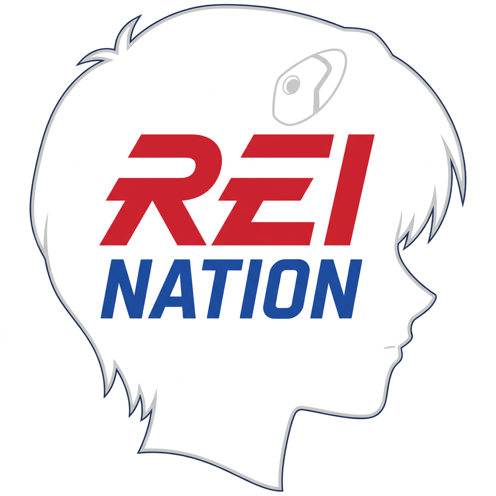

<p align="center">
  
</p>

<h3 align="center">Bringing EA Nation games back online</h3>

<p align="center">
  A Go replacement for <b>EA Nation's Aries and FESL online services</b>,<br>
  with PlayStation 2 adapters for <b>NASCAR Thunder 2004</b> and <b>TimeSplitters: Future Perfect</b>.
</p>

<p align="center">
  
  
  
  <a href="https://github.com/dead-game-entrepreneurs/rei-nation/actions/workflows/go.yml"></a>
</p>

<p align="center">
  <a href="#status">Status</a> ·
  <a href="#dns-redirects">DNS redirects</a> ·
  <a href="#running-the-server">Running the server</a> ·
  <a href="docs/games/nascar04/online-map.md">NASCAR 04 notes</a> ·
  <a href="docs/games/tsfp/online-map.md">TSFP notes</a> ·
  <a href="#credits">Credits</a>
</p>

---

## Status

**NASCAR Thunder 2004** (US PS2, `SLUS-20824`) is the first adapter. Testing used two PCSX2 clients on a LAN.

| Feature | Status |
| --- | --- |
| Account creation, persona selection and login | ✅ tested in game |
| Regional rooms, player previews and created rooms | ✅ tested in game |
| Head-to-head challenges and declines | ✅ tested in both directions |
| Direct and relayed race traffic | ✅ tested on a LAN |
| Ranked results after a lobby reconnect | ✅ a ranked result updated both drivers' standings |
| EA Messenger buddy presence and direct messages | ✅ tested between two clients after a race |
| Inbox replay, account recovery and relay ownership | 🧪 covered by automated tests |
| Physical consoles, other disc regions and Internet NAT combinations | 🧪 awaiting wider testing |
| Relay for EA SPORTS Talk | Unimplemented |

The client owns race simulation. The server handles accounts, rooms, Messenger, peer setup, and ranked statistics. Message history is restored after the client loads its buddy and ignore lists. The game can display restored messages as unread again.

**TimeSplitters: Future Perfect** (US PS2, `SLUS-21148`) is enabled alongside NASCAR 04 by default.

| Feature | Status |
| --- | --- |
| FESL account login and persona selection | ✅ tested on a stock PS2 |
| Theater matchmaking and endpoint discovery | 🧪 covered by automated tests |
| Messenger friends, presence and offline messages | 🧪 covered by automated tests |
| Map sharing, ratings and persona statistics | 🧪 covered by automated tests |
| Direct play on a LAN | 🧪 ready for a two-console test |
| Internet play and the optional UDP relay | 🧪 awaiting WAN and NAT-compatibility tests |

The TSFP adapter uses the retail client's SSLv2 transport, keeps title-specific
wire behavior under `internal/games/tsfp`, and shares accounts, social storage,
mail and PostgreSQL infrastructure with the other adapters. See the
[TSFP operator guide](docs/games/tsfp/online-map.md) for its service flow and
remaining validation work.

## How it fits together

```text
PS2 / PCSX2 ── DNS ──────────▶ your resolver
     ├── DNAS ───────────────▶ separately configured DNAS service
     ├── NASCAR Aries ───────▶ Rei Nation TCP 10600
     ├── NASCAR Messenger ───▶ Rei Nation TCP 5000
     ├── TSFP FESL ──────────▶ Rei Nation TCP 18070
     ├── TSFP Theater ───────▶ Rei Nation TCP and UDP 18071
     ├── TSFP Messenger ─────▶ Rei Nation TCP 18072
     └── Game traffic ───────▶ the other console directly or through a configured relay
```

The lobby issues the key used to authenticate Messenger on its own connection. The game can close and reopen its lobby socket during a race while Messenger stays connected. The [NASCAR 04 network map](docs/games/nascar04/online-map.md) covers the wire protocol and result flow.

## DNS redirects

Point `ps2nascar04.ea.com` at the IPv4 address your PS2 or PCSX2 clients use to reach the server. Use that same address for `REI_NATION_PUBLIC_IP` in `.env`.

```text
address=/ps2nascar04.ea.com/192.0.2.10
```

Replace `192.0.2.10` with your server address. The line above is for dnsmasq. Use [configs/nascar04.dns.yaml](configs/nascar04.dns.yaml) for revive-dns. Configure the PS2 network profile or PCSX2 to use your resolver and keep DNAS routing configured separately.

For TSFP, redirect `tsfp.fesl.ea.com` to the same advertised address. A [revive-dns example](configs/tsfp.dns.yaml) is available. The two titles can share the resolver.

## Running the server

Use Docker Compose on a Linux host with host networking.

```sh
git clone https://github.com/dead-game-entrepreneurs/rei-nation.git
cd rei-nation
cp .env.example .env
chmod 600 .env
```

Set `REI_NATION_PUBLIC_IP` in `.env` to the server's LAN or public IPv4 address.
Choose a unique `POSTGRES_PASSWORD`. NASCAR 04 and TSFP run together by
default. Set `REI_NATION_GAMES` only when intentionally limiting a deployment
to a subset of the supported adapters. Then start the stack.

```sh
docker compose up -d --build --wait
docker compose logs -f rei-nation
```

Allow these ports for the features you use.

| Port | Purpose |
| --- | --- |
| TCP 10600 | Aries directory and lobby |
| TCP 5000 | EA Messenger |
| UDP 3658, 3659, 9999 | Peer relay |
| TCP 3658 | ProtoMangle HTTP helper for compatible clients. This NASCAR race path does not use it. |
| TCP 18070 | TSFP FESL |
| TCP and UDP 18071 | TSFP Theater and endpoint discovery |
| TCP 18072 | TSFP Messenger |
| TCP 18073 | Optional remote-relay control; restrict to the registered relay IP |
| UDP 20000–20255 | Optional TSFP peer relay on its separate public address |

PostgreSQL and `/healthz` bind to the host loopback interface on ports `55434` and `8086` by default. `docker compose down` stops both services and keeps the database volume. The legacy client uses plaintext Aries on the network. Create an account password dedicated to the game.

The image includes the TSFP FESL certificate and key under `/tsfp-certs`, so
Compose does not need a certificate volume. Direct binary runs can override the
paths with `REI_NATION_TSFP_CERT` and `REI_NATION_TSFP_KEY`.
Because direct binary runs also select both games by default, they must point
those variables at readable certificate files (for a source checkout, use
`configs/tsfp-certs/fesl-cert.pem` and `configs/tsfp-certs/fesl-key.pem`). An
existing NASCAR-only binary deployment can instead keep its previous behavior
with `REI_NATION_GAMES=nascar04`.

### Relay

Set `REI_NATION_RELAY` in `.env` to choose the route before matchmaking hands off to the clients.

| Value | Behavior |
| --- | --- |
| `auto` | Uses direct play until the host's public mapping is verified, then selects the relay for distinct public addresses. |
| `always` | Prefers the relay when both peers have distinct source IPv4 addresses, including on a LAN. |
| `off` | Uses direct play. |

For TSFP, relay members are pinned to the UDP address observed during matchmaking; packets from another source port are rejected. This requires endpoint-independent NAT behavior: a NAT that assigns a different public source port for Theater and relay traffic cannot use the relay. If both consoles share an address, the server offers direct play. The stock client accepts one endpoint per attempt and has no automatic relay retry. NASCAR race traffic uses the relay independently; EA SPORTS Talk uses UDP `6000` directly between peers.

If the remote relay restarts or expires an active room, Rei Nation tears down
that match when it detects the lost state so players restart matchmaking with
current relay ports instead of continuing with stale destinations.

The TSFP relay must use a public IPv4 distinct from Theater. If that address is
assigned to the same host, set `REI_NATION_TSFP_RELAY_IP` and leave the remote
relay settings empty. For a separate relay host, also set
`REI_NATION_TSFP_RELAY_TOKENS`, `REI_NATION_TSFP_RELAY_CONTROL_CERT`, and
`REI_NATION_TSFP_RELAY_CONTROL_KEY`. The token registry uses the original
`name sha256:<digest> public-ip` format and stores no plaintext token.

Build the remote node and install the supplied systemd unit and environment
template from `deploy/`. The node keeps the plaintext token in its root-owned
token file, pins the control certificate, and dials Theater over TLS. Theater
also verifies the token digest, node name, declared public address, and TCP
source address. Allow its UDP range publicly and allow TCP 18073 on Theater
only from the registered relay address.

```sh
CGO_ENABLED=0 go build -trimpath -ldflags="-s -w" -o tsfp-relay ./cmd/tsfp-relay
```

### Messenger and account recovery

If the game's fast sign-in restores the lobby but Messenger still errors, sign out of EA Online and sign back in to rerun the game's Messenger startup.

To enable **Forgot Account Name** and **Forgot Password**, configure `REI_NATION_SMTP_ADDR` and `REI_NATION_SMTP_FROM`. The mail server must support STARTTLS. Set `REI_NATION_SMTP_USER` and `REI_NATION_SMTP_PASSWORD` if it requires authentication. A recovery password expires after 30 minutes or becomes the account password on first use. Players can then choose another password with **Edit Account**.

### Migrating an original TSFP server

The SQLite importer preserves account IDs, legacy passwords, personas,
friendships, queued messages, maps and map ratings. Take a consistent copy of
the original `accounts.sqlite3`, initialize an empty Rei Nation database, stop
the Rei Nation process while importing, and run:

```sh
set -e
docker compose up -d --build --wait
docker compose stop rei-nation
import_sql="$(mktemp)"
trap 'rm -f "$import_sql"' EXIT
python3 scripts/migrate-tsfp-sqlite.py /path/to/accounts.sqlite3 > "$import_sql"
docker compose exec -T postgres psql -v ON_ERROR_STOP=1 -U eanation -d eanation < "$import_sql"
docker compose start rei-nation
```

The importer is transactional and refuses to load into a database that already
contains accounts. When legacy accounts reuse one recovery email, the first
account keeps it and later duplicates are cleared to satisfy Rei Nation's unique
email rule. The retired Django production database has already been migrated;
its one-time importer is intentionally not part of the active server tooling.

## Development

Use the Go version in [go.mod](go.mod). Run the same checks as GitHub Actions.

```sh
go test -race ./...
go vet ./...
go build -o bin/rei-nation ./cmd/rei-nation
```

Run `scripts/test-integration.sh` on Linux with Docker and OpenSSL to test NASCAR's deployed sockets and TSFP's PostgreSQL-backed service flows in a disposable Compose project. It binds the test stack to loopback. `REI_NATION_TEST_BIND`, `REI_NATION_TEST_PG_PORT`, and `REI_NATION_TEST_HEALTH_PORT` can move the test listeners if their defaults are already in use.

Pushes to `main` deploy both the server and remote TSFP relay only after the
verification and integration jobs pass. Deployment credentials live in the
protected `production` GitHub environment, never in the public repository.
An organization administrator must approve each production job. The SSH key is
also restricted on each host to the matching script under `deploy/`.

Title adapters live under `internal/games`. `internal/protocol/aries` handles wire framing and TCP connections, `internal/connectivity` handles peer introduction, and `internal/storage` handles PostgreSQL persistence.

## Credits

- [mrsavage0789](https://github.com/mrsavage0789) led the original local PS2 revival and NASCAR Thunder 2004 client research that made this port possible.
- [a-blondel and the EA Nation Server contributors](https://github.com/a-blondel/ea-nation-server) provided the GPLv3 Aries server implementation and codec reference. The Go SSC2 decoder adapts the upstream `CryptSSC2` and `LobbyTagField` code and uses a public upstream test vector.
- [mohh-master-server contributors](https://github.com/a-blondel/mohh-master-server) developed the predecessor to EA Nation Server.
- [riperiperi and Breakin-In contributors](https://github.com/riperiperi/Breakin-In) published the Apache-2.0 server for The Sims: Bustin' Out (PS2). Rei Nation's initial Go adapter targets NASCAR Thunder 2004.
- [Quetzal contributors](https://github.com/dead-game-entrepreneurs/quetzal) provided the reference for the Docker and DNS setup.
- [The original TSFP server](https://github.com/princebyyourlogic/tsfp-server-recreation/tree/1de3a50c04a5a3389f927db7ca63a4833771605d) provided the PS2 service implementation and client research used for the Go adapter.

## License

Rei Nation is distributed under the [GNU General Public License, version 3](LICENSE). It is an independent preservation project. Game names belong to their respective owners.
